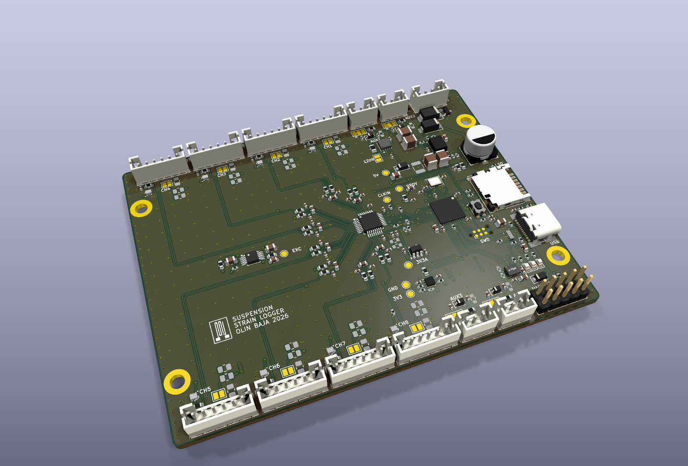
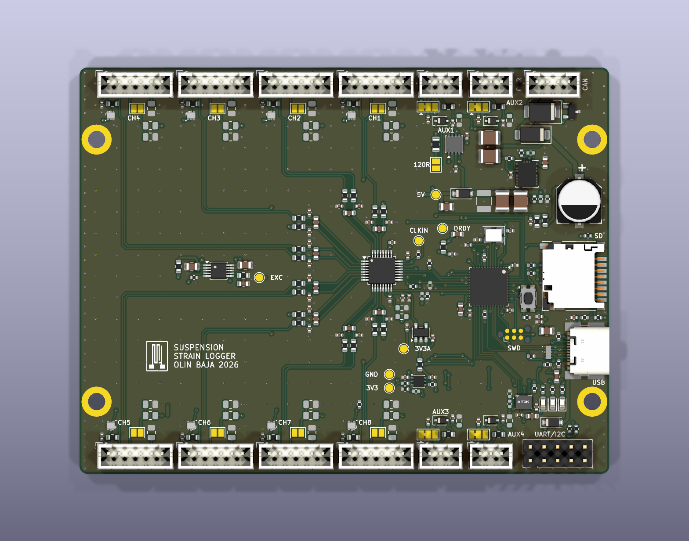
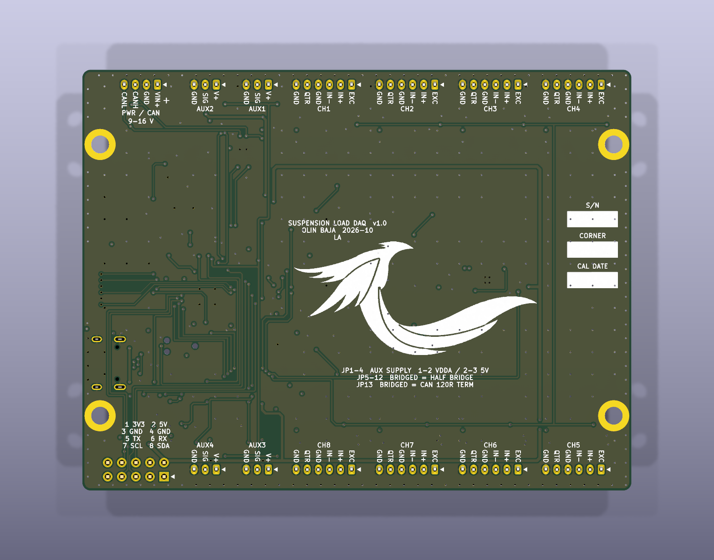
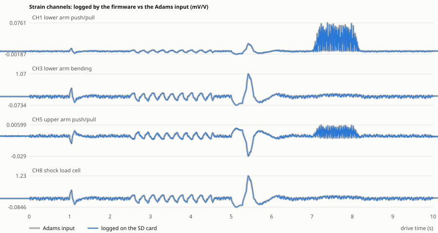
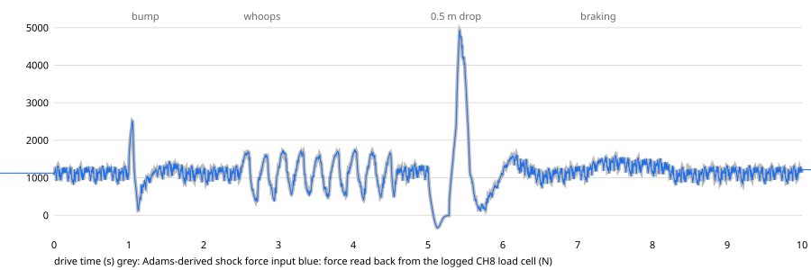
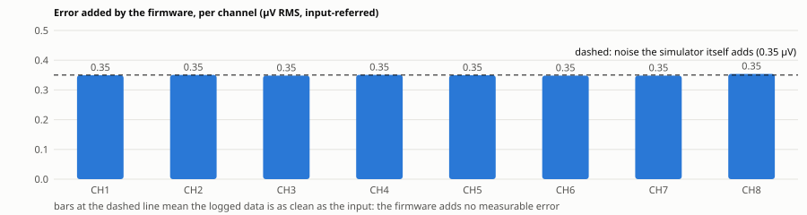
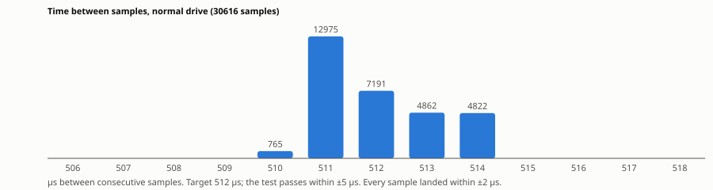

# Baja Suspension Load Logger

A data logger that bolts onto one corner of the Baja car and records the forces in the suspension arms while the car drives. The arm design currently uses estimated loads ("3 g bump", "5 g landing"); this board replaces them with measured ones.

| Top | Bottom |
|---|---|
|  |  |

Every connector pin is labeled on the bottom of the board.

For documentation:
- **S/N:** the board's serial number (01, 02, …), to tell identical boards apart.
- **CORNER:** which corner of the car the board is mounted on (LF, RF, LR or RR), so each data file can be matched to its corner.
- **CAL DATE:** the date the strain gauges wired to this board were last calibrated on their arm. The board also checks its own calibration automatically at the start and end of every run; this date is for the arm calibration.

## Does the firmware work?

The real firmware runs on a PC, connected to simulated versions of the board's chips. It is fed a 10 s drive from the Adams model: a bump, whoops, a 0.5 m drop and braking. The SD card file it writes is then checked sample by sample against that input.

**What was logged matches the input.** The blue line is what the firmware saved; the grey line underneath is the Adams input.

**Shock force is right.** Peak landing force logged 4930 N, against 4929 N in the Adams model.

**The firmware adds no error.** The error on each channel is no larger than the noise the simulator itself puts in.

**No samples lost, and the timing is steady.** All 30,616 samples were saved, each within 2 µs of its 512 µs slot.

## What it measures

| Where | What | Sensors |
|---|---|---|
| Lower control arm | Push/pull and bending | 4 strain gauges |
| Upper control arm | Push/pull and fore-aft | 2 strain gauges |
| Toe link | Push/pull | 1 strain gauge |
| Shock | Force, as a cross-check | 1 load cell |
| Shock travel and extras | Position sensors | 4 inputs |
| Chassis motion | Acceleration and rotation | Built-in motion sensor |

All 8 force channels are sampled at the same instant, about 2,000 times a second, onto a microSD card.

## More detail

- [Design specification](spec.md)
- [Schematic (PDF)](fab/rev-b/docs/suspension-load-daq-schematic.pdf)
- [Parts list (CSV)](fab/rev-b/assembly/suspension-load-daq-BOM-full.csv)
- [Ordering files](fab/rev-b/README-fab.md)
- [Firmware build instructions](firmware/README.md)
