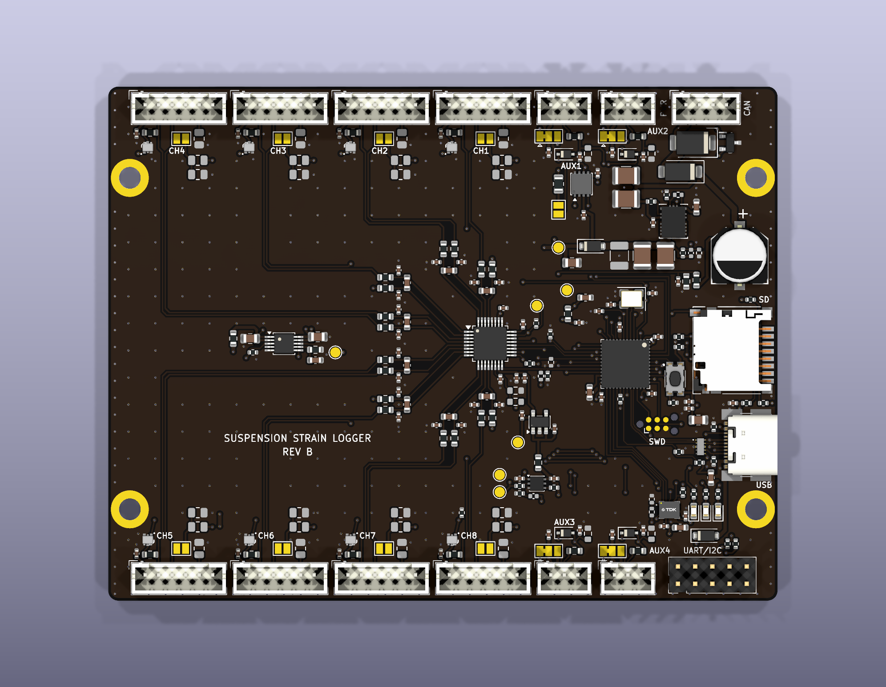

# Suspension strain-gauge logger

One board per Baja suspension corner. It logs 8 strain-gauge bridges, 4 aux sensors (e.g. shock travel), battery voltage and a 6-axis IMU to microSD. The logs are later calibrated into arm forces for stress and fatigue work. Hardware: STM32F412 MCU, ADS131M08 bridge ADC, ICM-42688 IMU, microSD, CAN and USB-C (Rev B, in `eda/`, `fab/rev-b/` and `string-gauge-daq.zen`).



## Start here

| If you want to… | Read this |
|---|---|
| See what the board must do and what's still open | [spec.md](spec.md) |
| See the firmware test results | [firmware/test/results/summary.md](firmware/test/results/summary.md) |
| Look at the circuit | [Schematic (PDF)](fab/rev-b/docs/suspension-load-daq-schematic.pdf) |
| Look at the board layout | [Layers (PDF)](fab/rev-b/docs/suspension-load-daq-layers.pdf), [top render](fab/rev-b/renders/suspension-load-daq-top.png), [bottom render](fab/rev-b/renders/suspension-load-daq-bottom.png), [3D model (STEP)](fab/rev-b/3d/suspension-load-daq.step) |
| Order or assemble boards | [fab/rev-b/README-fab.md](fab/rev-b/README-fab.md) (gerbers zip, JLCPCB BOM and placement files) |
| See the parts list | [Full BOM (CSV)](fab/rev-b/assembly/suspension-load-daq-BOM-full.csv) |
| Understand how the firmware works | [How the firmware works with the board](#how-the-firmware-works-with-the-board), below |
| Build, test or flash the firmware | [Firmware](#firmware), below |

## What's in each folder

| Folder / file | What it is |
|---|---|
| `spec.md` | Design specification for Rev B: requirements, channel table, open items |
| `board-spec.md` | The original requirements brief written as input to Diode (informal; `spec.md` supersedes it) |
| `firmware/` | Logger firmware: `src/` (C code), `test/` (PC simulator and tests), `tools/sdlog.py` (log decoder) |
| `fab/rev-b/` | Everything for manufacturing: gerbers, BOM/placement, schematic and layer PDFs, renders, DRC/ERC reports |
| `eda/` | KiCad project (schematic and PCB) |
| `string-gauge-daq.zen` | Diode board source the KiCad project is generated from |
| `analysis/` | Python scripts: expected suspension loads, geometry checks |
| `data/` | Reference vehicle data (Adams mini baja model, Olin Baja hardpoints), each with its own README |
| `components/`, `modules/`, `vendor/`, `pcb.toml` | Part libraries and config used by the Diode `pcb` tool. No need to read these |

## How the firmware works with the board

- **One clock.** The MCU passes its 8 MHz crystal to the ADC through MCO1. Samples and timestamps can't drift apart.
- **The ADC sets the pace.** Each ADC "data ready" (1953 per second by default) triggers an interrupt. It reads all 8 bridges at once, then reads the IMU on its own SPI bus and the latest aux/battery scan, and stores one 60-byte record.
- **Shared SPI bus.** The ADC and SD card share SPI1. The main loop moves 512-byte blocks from a 128 KB RAM buffer to the card in short steps that fit between ADC samples. A slow card stall is absorbed by the buffer. If the card stalls longer than about 1 s, the lost samples are counted and marked in the file.
- **Each run calibrates itself.** At start: excitation on, 1 s settle, then a shunt-cal step (all 8 shunt resistors on together). At stop: the same shunt step, then excitation off. The firmware compares the two steps and flags a gain drift above 0.5%.
- **Raw data only.** ADC codes are stored unchanged. Filter correction and force calibration happen later on a PC.
- **Log file.** Each run is a new `RUNnnnnn.BIN`, preallocated in one piece on a FAT32 card. Its text header holds the rate, gains and the contents of `CONFIG.TXT` from the card: driver, track, tyre pressures, sensor IDs and similar run notes.
- **Control.** Start and stop come from the UART console, a CAN command, or autostart. One board, the CAN master, broadcasts start/stop and a 10 Hz sync so several corner boards can be lined up afterwards. With USB power only, everything except CAN still works.

## Firmware

```sh
make -C firmware test        # run the firmware in the PC simulator on the Adams drive (no hardware needed)
make -C firmware check-arm   # compile the STM32 code for Cortex-M4 with clang
make -C firmware             # build firmware.bin (needs arm-none-eabi-gcc); make flash writes it over SWD
python3 firmware/tools/sdlog.py RUN00001.BIN out.csv   # decode a log
```

`firmware/src` is plain C with no vendor libraries. Hardware access sits behind `hal.h`, so the same code runs on the board (`src/stm32`) and in the simulator (`test/sim`). The test drives a rear corner over bumps, whoops, a 0.5 m drop and braking. The input comes from the Adams mini baja spring, damper, tire, hardpoint and mass data. The test checks every logged sample against that input: [results](firmware/test/results/summary.md).

**Not yet done:** the firmware has not run on real hardware. USB data download is not implemented, so take the card out to get the logs. The bench tests in `spec.md` (noise, 30-min logging on a real card, fault tests) are still open, along with the sealed connectors and enclosure.
